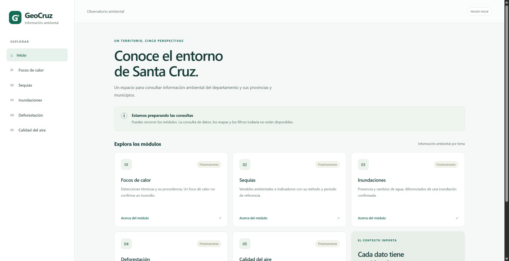

# SET-01 · Base Laravel Blade y API

Issue [#15](https://github.com/elingeyesdev/t6-medicion-ambiental/issues/15). Rama `feature/15-base-web-api`. Milestone M2. EDT 3.1, actividad PERT C.

Preparación y ejecución: Josué Padilla, 15/10/2026, hora de Bolivia. Revisión pendiente de Jaziel; esta evidencia no acredita su aprobación.

## Resultado

Se incorporó Laravel **12.70.0** con dependencias fijadas, página Blade y navegación entre las cinco entradas de módulos. Las pantallas indican que las consultas todavía no están disponibles. Se publicó la comprobación operativa JSON `/api/salud` y el diagnóstico `/up` de Laravel. Las rutas de API conservan errores JSON sin exigir sesión.

La instalación estándar usa Composer; Windows también dispone de `preparar.ps1`, `iniciar.ps1` y un ejecutor de PHP portable. La preparación genera configuración y clave únicamente cuando faltan y conserva los archivos existentes al repetirse. El ejecutor no modifica la instalación global de PHP.

## Verificaciones ejecutadas

- Entorno local: Windows, PHP 8.3.30, Composer 2.10.3, PHPUnit 11.5.57.
- `composer validate --strict`: válido.
- `composer lint`: formato correcto.
- `composer test`: **15 pruebas aprobadas, 79 aserciones**.
- `composer audit --locked --no-dev`: sin avisos de vulnerabilidad publicados en la consulta del 15/10/2026.
- SQLite local conservado: su SHA256 antes y después de las pruebas coincide. La prueba de escritura emplea `:memory:`.
- Repetición de `preparar.ps1`: hashes de `.env` y SQLite sin cambios; la clave existente no se imprime ni se guarda como evidencia.
- HTTP real local: inicio, página de Focos de calor, `/api/salud`, `/up` y CSS respondieron 200. Se conserva JSON con estado, tipo de contenido y fecha real.
- Navegador Chrome: inicio → Focos de calor (pendiente) → Explorar otros módulos → inicio. Se capturó la página real servida por Laravel.
- Git excluye `.env`, SQLite, `vendor/` y herramientas temporales. No se trasladó código de estaciones o PR de la práctica.

La configuración de GitHub Actions ejecuta instalación fijada, validación, formato y pruebas en PHP 8.2 y 8.3. Los resultados remotos se consultan en el PR; no se confunden con esta ejecución local.

## Evidencia

- [Pruebas](evidencias/set01_20261015/pruebas.txt).
- [Validación de Composer](evidencias/set01_20261015/composer_validacion.txt).
- [Formato](evidencias/set01_20261015/formato.txt).
- [Comprobación HTTP real](evidencias/set01_20261015/http.json).



## Cómo reproducir

Desde la raíz oficial, Windows con PHP en PATH:

```powershell
.\preparar.ps1
.\iniciar.ps1
```

Abrir http://127.0.0.1:8000. En otra terminal, dentro de `web/`, ejecutar `..\herramientas\php.ps1 artisan test --compact`. Con PHP/Composer configurados normalmente se usa `composer test` desde `web/`.

Requisitos y comandos: [Web y API](../web/README.md). URLs para PC, Android Emulator y dispositivo físico: [Desarrollo compartido](../compartido/DESARROLLO.md).

## Límites y revisión

La salud declara alcance **aplicacion**: no comprueba la base de datos ni las fuentes ambientales. No hay consultas NASA, catálogo territorial adoptado, mapas, filtros operativos o cliente Flutter en esta tarea. Tampoco se realizó una prueba en emulador o teléfono: las direcciones compartidas son instrucciones para #17 y #20.

El PR se dirige a `develop` y debe revisarlo Jaziel. Las primeras cuatro actividades de #15 cuentan con implementación y evidencia; la aceptación final permanece pendiente de la revisión del compañero. #16, #17, #18 y #19 conservan sus respectivos alcances.
