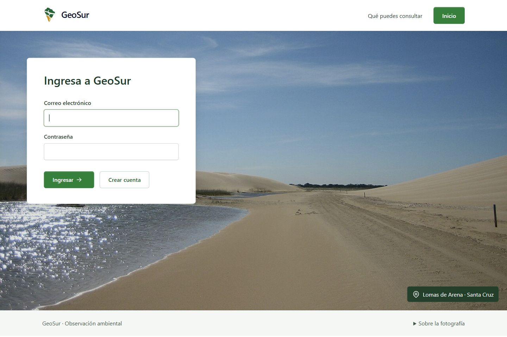
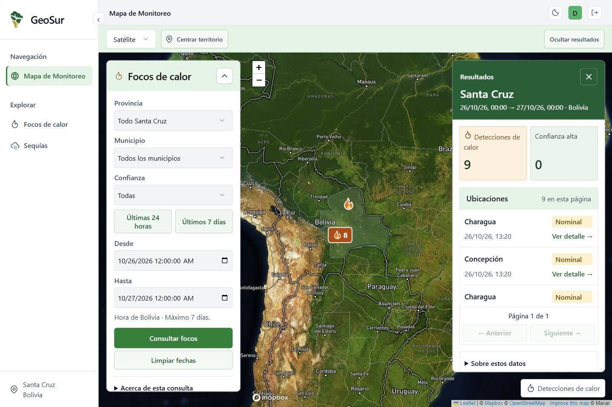

# Revisión de interfaz y preparación de GeoSur

Pruebas realizadas entre el 27 y el 28/10/2026. Seguimiento #57, #58, #60, #61 y #62; PR #55, pendiente de revisión de Jaziel. Tabler 1.7.1, Segoe UI/Arial y texto normal de 16 px. El cambio de nombre no completa la migración de EnviroSense.

- `01-ingreso-fondo.png`: GeoSur, Lomas de Arena como fondo y formulario más arriba; campos vacíos, sin credenciales en la captura.
- `02-mapa-controles.png`: consulta real del 26/10 00:00 al 27/10 00:00, hora de Bolivia. Nueve detecciones; un grupo conserva ocho registros. Barra separada del panel de resultados y botón de cierre visible.
- `03-sequias.png`: piloto histórico julio–septiembre de 2024, una muestra, 114,5 mm y condición Normal. Detalle y fuentes sin caché, hashes ni horarios internos. La celda y el municipio consultado siguen diferenciados.
- `04-fechas-movil.png`: accesos a 24 horas y siete días y límites del formulario, ancho 390 × 844.
- `05-resultados-movil.png`: herramientas y resultados ocupan zonas distintas; no se superponen. En 390 px la barra mide 112 px y los resultados quedan debajo del mapa.
- `06-inicio-geosur.png`: se conserva la foto de Amboró y los accesos a las consultas existentes. Se indica su cobertura actual de Santa Cruz.
- `07-ingreso-movil.png`: formulario sobre Lomas de Arena, sin desbordamiento horizontal.

Se probó ingreso demo, salida, cierre/reapertura de resultados y selección de Concepción después de cerrar el panel: la ficha vuelve a abrirse y se centra esa detección. Se probaron ambos accesos temporales. El formulario inicial abarca exactamente siete días hasta el instante de apertura; una fecha futura escrita quedó inválida frente a su máximo. Los tests también comprueban zona horaria, cruce de mes/año, 168 horas exactas y rechazo de futuro antes de llamar al proveedor.

La pantalla de sequías detectó correctamente que el piloto había vencido. Se renovó solo el objetivo con `sequias:preparar-consulta scz-piloto-01 2024-09 --consultar --renovar`, reutilizando la base existente. Se conservó el resultado SPI −0,6410480784 y su lluvia de 114,5 mm; los originales y el manifiesto permanecen en almacenamiento privado. No se descargaron otras 55 series ni imágenes satelitales. La vigencia del objetivo renovado termina el 29/10 a las 03:59 UTC (28/10 a las 23:59 Bolivia); una nueva revisión posterior requiere renovar, no alterar sus fechas.

Comprobaciones locales: **248 pruebas Laravel / 1770 assertions**, **48 JavaScript** y Pint correctos. El catálogo `/api/v1/paises` devolvió 13 entradas, doce países y Guyana Francesa como territorio; el filtro BR devuelve Brasil. Se comprobaron sus archivos de procedencia y que no se hacen llamadas externas para leer el catálogo.

M2 quedó publicada por #59 y `v0.2.0`: main contiene el mismo árbol que el corte aprobado e9a591c. Las ocho tareas nuevas #60–67 aparecen en Project 13, comprobado en el navegador; la CLI no tenía el alcance de lectura de Projects, pero el flujo automático ya las había añadido. M3 quedó sin fecha de vencimiento porque Josué aclaró que el jueves corresponde a M2 y aún no sabe cuándo será M3. Las tareas abiertas no se declaran aprobadas ni cerradas por estas pruebas.

